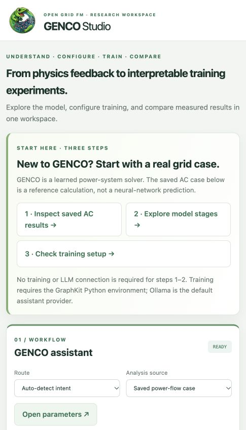
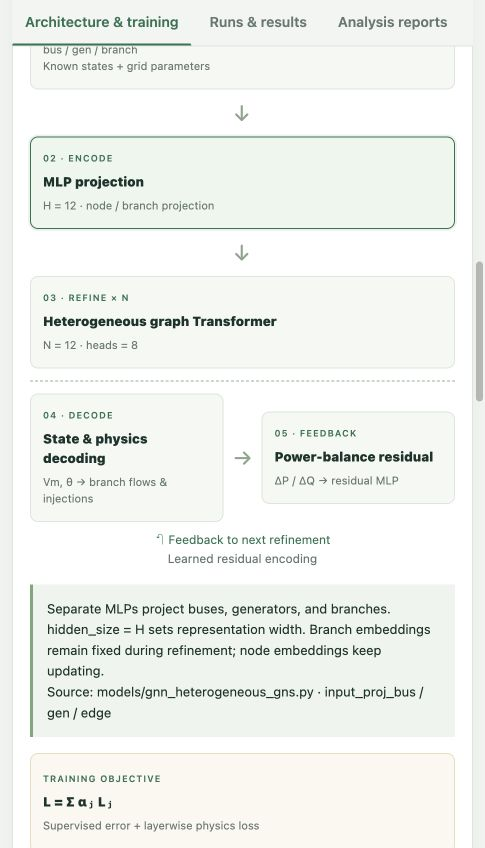
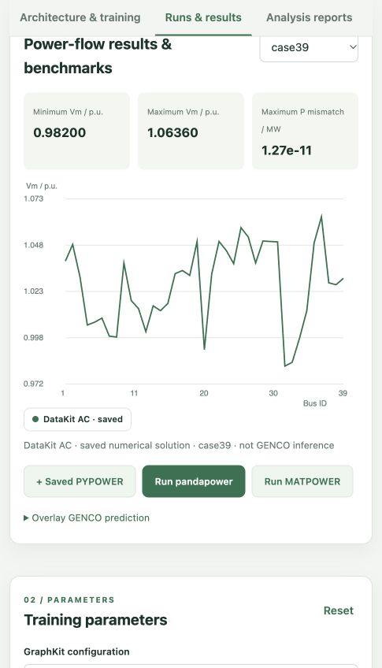
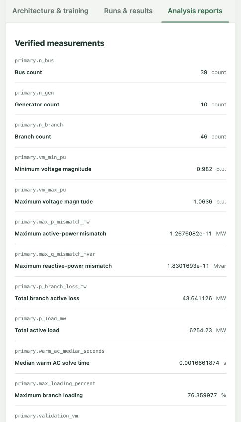

# GENCO Studio — LLM for GENCO

A local, web-based workspace for learning the GENCO architecture, configuring GraphKit training, exploring recorded power-flow results, comparing AC solvers, and creating evidence-based reports. The assistant uses **Ollama by default** and can be switched to the OpenAI API. The GENCO mascot is shown at the upper-left of the interface.

This README follows the **Summary → Motivation → Method → Results → Limitations** narrative of the [GENCO Challenge example discussion](https://huggingface.co/spaces/gridfm/genco-challenge/discussions/1). The screenshots below are from the running local application, not mockups.

## Summary: a five-minute path for power-system engineers

If you know power flow but have never used GENCO, follow the three buttons at the top of the page:

1. **Inspect saved AC results.** Start with case39 and read the bus-voltage curve. This is a saved DataKit numerical solution, **not a GENCO neural-network prediction**.
2. **Explore model stages.** Click a stage to see what electrical quantities it handles, which trainable components it uses, and which panel settings affect it.
3. **Check training setup.** Preflight verifies the selected data and Python environment before any training job is submitted.



*Figure 1. The first screen separates reference AC data, architecture exploration, and the optional training environment.*

## Motivation

A conventional power-flow user should not have to infer whether a plot shows a Newton solver result, a saved dataset, or GENCO inference. GENCO Studio therefore keeps data provenance visible, labels configuration-derived diagrams separately from measured metrics, and blocks training when basic prerequisites fail. Questions are read-only; parameter changes, training, analysis, and multi-step plans have distinct routes.

## Method

### Run locally

The web/API environment is lightweight and separate from the GraphKit training environment. With Python and Node.js installed:

```bash
python -m venv .venv
.venv/bin/python -m pip install -r requirements.txt
# On a different machine, copy .env.example to .env.local and set GENCO_ROOT.
bash scripts/start_local.sh
```

Open [http://127.0.0.1:8017/](http://127.0.0.1:8017/). The startup script checks the web interpreter, checks/builds the frontend, loads the optional `.env.local`, and binds only to localhost. The frontend has no runtime npm/CDN dependency. The server uses `dist/` when present and `frontend/` otherwise. Run `.venv/bin/python -m scripts.check_delivery` for a read-only source/data/training diagnostic.

| Setting | Purpose |
|---|---|
| `GENCO_ROOT` | Root of the local OpenGridFM installation; otherwise the app checks a sibling directory and the standard Box checkout layout |
| `GENCO_PYTHON` | Python interpreter with GraphKit training dependencies; defaults to the web server's interpreter |
| `BENCHMARK_PYTHON` | Python interpreter with pandapower/NumPy for the benchmark job |
| `OLLAMA_BASE_URL` | Ollama server; default `http://127.0.0.1:11434` |
| `OLLAMA_MODEL` | Default assistant model, initially `llama3.1:8b` |
| `OPENAI_API_KEY` | Server-side credential for the optional OpenAI provider |
| `MATPOWER_ROOT` | Local MATPOWER installation directory |
| `OCTAVE_BIN` | Optional Octave executable path |

Install GraphKit's declared dependencies in the interpreter selected by `GENCO_PYTHON`. The web app running successfully does **not** establish that the training environment is ready. Use **Check training prerequisites** first. This probe does not import native libraries, so passing it still does not guarantee a complete training run.

### Understand the network before changing settings

The diagram is guided by the [GENCO paper, Fig. 3 and §4](https://arxiv.org/pdf/2608.09921#page=7), while the parameter mappings follow the local GraphKit implementation in `gridfm_graphkit/models/gnn_heterogeneous_gns.py` and `gridfm_graphkit/training/loss.py`. The selected YAML determines whether the task is PF, OPF, or SE; do not treat a task change as a simple hyperparameter toggle.



*Figure 2. Select projection, refinement, decoding, feedback, loss, or optimization to reveal the relevant explanation and editable fields.*

| Stage | What changes in the computation | Main controls |
|---|---|---|
| Input and split | Bus/generator/branch graph, known states, training/validation/test assignment | `seed`, `workers`, `val_ratio`, `test_ratio` |
| Feature projection | Initial learned embeddings for node and branch features | `hidden_size` = H |
| Iterative refinement | Heterogeneous attention/message passing and physics feedback repeated N times | `num_layers` = N, `attention_head`, `dropout` |
| Decoder and feedback | State estimates are decoded; power-balance residuals are encoded for the next refinement | Task-specific decoder in YAML; physics loss settings |
| Training objective | Supervised loss and layerwise physics losses are mixed | `loss_weight_*`, `base_weight` = λ |
| Optimization | Backpropagation updates learned projection, attention, decoder, and residual-encoder weights | `learning_rate`, `batch_size`, `epochs`, `patience` |

For the local `LayeredWeightedPhysics` implementation, the stage weight is proportional to `λ^(N−i)` and normalized across stages. Smaller λ emphasizes later refinements. The bar chart is calculated from the YAML configuration; it is **not a measured loss curve**. The physics-loss mixing coefficient is a separate `loss_weight_*`. Changing N also updates the monitored last-layer residual checkpoint name. Other model families do not expose GENCO-only controls.

Manual edits and assistant-proposed edits use the same backend validator. Each submitted training job gets its own YAML snapshot; the source configuration is not overwritten. The panel offers a preview, YAML export, before/after differences, and undo for the last assistant change.

### Assistant routes and execution

Choose a route explicitly or let the classifier select it. Quick examples populate the editor for review; they do not submit automatically.

| Route | Result | Side effect |
|---|---|---|
| `QUESTION_GENERAL` | Architecture/training explanation | None |
| `QUESTION_PARAMETER` | Explanation of a specific control | None |
| `PARAMETER` | Validated changes shown in the panel | Panel values only |
| `GENERATION` | Preflight, then a real GraphKit training subprocess | Creates a run only if ready |
| `ANALYSIS` | File-backed measurements plus cited LLM interpretation | Creates a report |
| `PLANNER` | Up to eight explicit steps | Runs only as the user advances or enables automatic execution |

The classifier uses structured JSON and backend validation. Question routes cannot change settings. The planner moves through `STEP_CONTROLLER`, waits for a training job to finish, and stops on failure through `ERROR_HANDLER`; it does not silently continue to analysis. Automatic execution works only while the page stays open. Stopping a plan does not cancel an already-submitted training process; cancel that job separately in **Runs & results**.

The assistant never executes arbitrary model-generated code or shell commands. Browser draft settings are saved locally. Plan state is in server memory and must be recreated after a server restart; job metadata remains under `runs/<id>/job.json`.

### Power-flow comparison and reports

The results panel loads actual saved DataKit AC CSVs for case39, case118, and ACTIVSg2000. Add the saved independent PYPOWER validation or launch a pandapower Newton AC run, then overlay its bus-voltage series. MATPOWER requires local Octave and MATPOWER; if absent, it reports unavailability instead of substituting another solver. A GENCO prediction can be imported as a single-scenario CSV with `bus_id,vm_pu,va_deg` and overlaid after exact bus-ID validation. Matching bus IDs alone does not prove that load, topology, settings, and units match.



*Figure 3. The plotted series is explicitly labeled as a saved DataKit numerical solution, not GENCO inference. The benchmark buttons add solver results to the same chart.*

Choose either two runs or two saved cases for a report. The program computes numeric tables from CSV/JSON files and recorded MLflow metrics; the LLM may add only interpretations that cite valid evidence keys and do not invent numbers. When the model is unavailable, the numeric report remains available with an explicit warning. Comparing different network cases is descriptive, not a solver ranking. Static voltage and power-flow values do not establish dynamic stability or compliance.



*Figure 4. The case39 report shows file-backed measurements and evidence keys; interpretation is kept separate from verified values.*

## Results and verification

On the local case39 saved AC result shown above, the recorded voltage range is **0.98200–1.06360 p.u.** and the maximum active-power mismatch is **1.27 × 10⁻¹¹ MW**. These values describe that saved numerical result only.

Run the checks with the web environment active:

```bash
pip install -r requirements-dev.txt
python -m unittest discover -s tests -v
npm run check
npm run build
```

The automated suite covers parameter path/checkpoint coupling, validation failures, read-only question routes, plan progression and error handling, job recovery, evidence scanning, prediction bus validation, and numeric-report provenance. The live-model smoke test is `python scripts/check_live_routes.py` while the local server and Ollama are running; it writes `runs/route-validation.json` and intentionally avoids launching training in an environment that fails preflight.

At the time of this README update, **26 automated tests pass** and the frontend checks/builds. The local Ollama smoke test exercised `QUESTION_GENERAL`, `QUESTION_PARAMETER`, `PARAMETER`, `ANALYSIS`, and `PLANNER`; `GENERATION` reached preflight and correctly refused a missing-dependency environment through `ERROR_HANDLER`. This does not claim that a full GENCO training run or OpenAI live call was verified. The selected training Python environment lacks GraphKit training packages; the previously inspected default Anaconda interpreter also had a Torch version outside the local GraphKit requirement.

## Limitations and next steps

- A complete training benchmark needs an isolated compatible GraphKit Python environment and matching training data.
- MATPOWER and OpenAI need their respective local installation or credentials; they are not silently emulated.
- Recorded solver timings include import/conversion/startup and should not be compared directly with batched GPU inference.
- The report citation validator checks evidence keys and numeric reuse, but expert review remains necessary for qualitative claims.
- Automatic GraphKit Parquet-to-single-scenario CSV prediction export is not yet implemented.

The interface and report methodology were also informed by the [other GENCO Challenge discussions](https://huggingface.co/spaces/gridfm/genco-challenge/discussions), especially their clear separation of experimental method, figures, runtime, and limitations.
